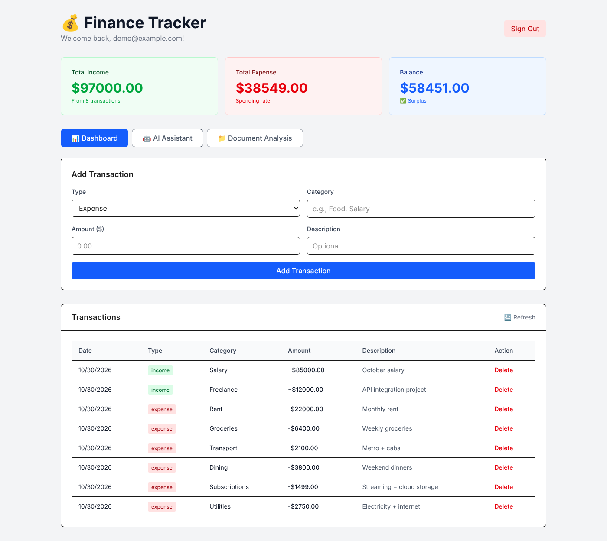

# Finance Dashboard

The web frontend for an AI-powered personal finance app. Track income and expenses, then ask an AI assistant about your spending, run agent-based financial analyses, and query your own bank statements with RAG.

**Backend:** [finance-tracker-api](https://github.com/kritagyasuryavanshi/finance-tracker-api) (FastAPI, LangChain, LangGraph, CrewAI)



## Features

**Dashboard**
- Live income, expense and balance summary cards
- Add, list and delete transactions

**AI Assistant**
- One-click AI insights on your spending (Gemini)
- Chat with your finances, with conversation history
- **Deep Analysis:** runs a LangGraph agent that scores your financial health and branches to a positive or alert report
- **Crew Analysis:** runs a CrewAI team of three agents (analyst, advisor, report writer)

**Document Analysis**
- Upload a CSV bank statement, which the backend chunks and embeds into a vector store
- Ask questions about it in plain English (retrieval-augmented generation)

**Auth**
- Signup and login with JWT; the token is attached to every API call by an Axios interceptor, and any 401 sends the user back to login

## Tech stack

- **Next.js 16** (App Router), **React 19**, **TypeScript**
- **Tailwind CSS 4**
- **Axios** API client with request/response interceptors
- React Context for auth state, custom `useTransactions` hook for data

## Project structure

```
src/
├── app/
│   ├── page.tsx            # Dashboard with Dashboard / AI Assistant / Document Analysis tabs
│   ├── login/page.tsx
│   └── signup/page.tsx
├── components/
│   ├── SummaryCard.tsx
│   ├── TransactionForm.tsx
│   ├── TransactionList.tsx
│   ├── AIInsights.tsx      # insights, chat, LangGraph and CrewAI analyses
│   ├── documentUpload.tsx
│   └── documentQuery.tsx
├── context/AuthContext.tsx
├── hooks/useTransactions.ts
└── lib/api.ts              # typed API client (auth, transactions, AI)
```

## Run it locally

Start the [backend](https://github.com/kritagyasuryavanshi/finance-tracker-api) first, then:

```bash
git clone https://github.com/kritagyasuryavanshi/finance-dashboard
cd finance-dashboard
cp .env.example .env.local    # NEXT_PUBLIC_API_URL=http://localhost:8000
npm install
npm run dev                   # http://localhost:3000
```
